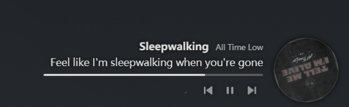
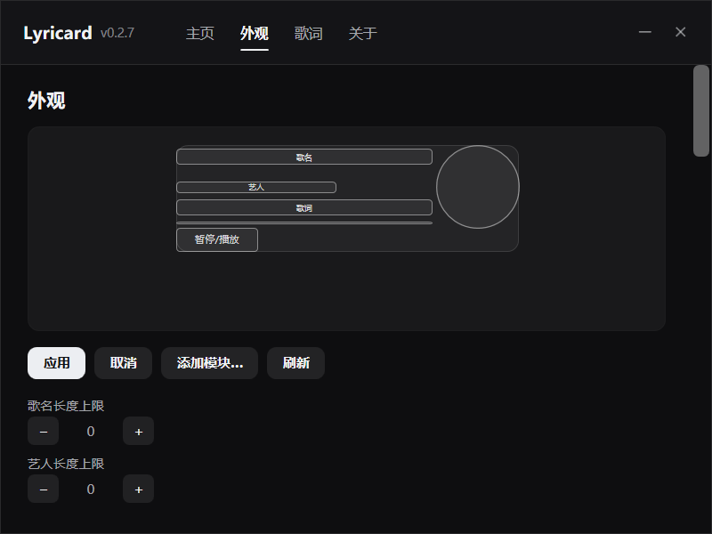

# Lyricard

**一张浮在桌面上的歌词卡片。** 默认盯着 Apple Music，也能跟网易云、QQ 音乐、酷狗、MD3Music、Spotify 等 9 家播放器 —— 谁在播就显示谁。

[](https://github.com/Liangpige/Lyricard/actions/workflows/build.yml)
[](LICENSE)
[](#快速使用)
[](https://github.com/Liangpige/Lyricard/releases/tag/v0.3.3)
[](#自己编译)



零安装、零管理员权限、无外部运行时依赖：单个 exe + 系统自带的 .NET Framework 4.x，配置与歌词缓存都放在 exe 同目录的 `data\`。

---

## 一张卡片，由你自己摆

v0.3 起，卡片的版式不再是写死的，而是**一份可编辑的模板**（`data\layout.ini`）。

- 「外观」页顶部既是**画板**：卡片上的每个模块（封面 / 歌名 / 艺人 / 专辑 / 歌词 / 进度条 / 按钮 / 律动条）都用虚线框画出来，拖到哪就是哪。
- 拖完点 **应用** 才写进模板并重排卡片；**取消** 撤销上一次应用；**刷新** 让画板重新读取当前模板（丢掉没应用的拖动）。
- 画板与卡片是 **1:1 同尺度**，同一个框在两边像素数一致；画板放不下就横向滚动，不会偷偷缩小。
- 卡片大小跟着内容走：模块移到哪，卡片就长到哪，不再保留空白边。
- 右键任意框：显示/隐藏、删除、添加模块。
- 三个「长度上限」把文字模块的框宽按字符数算好 —— 框就是文本框，超出部分加省略号。



## 外观

分割线上方是需要点「应用」的模板项（模块几何、长度上限），下方是改动立即生效的外观项：

| 分组 | 可调 |
| --- | --- |
| 文字 | 歌名/艺人/歌词的字号、颜色、对齐（居左/居中/居右）、歌名与艺人是否同框 |
| 进度条 | 长度、粗细、轨道色、填充色 |
| 封面 | 大小、圆形/方形、旋转（仅圆形）、饱和度、高光压制、亮度、对比度、色温、色相、暗角、双色调（暗部色 + 高光色 + 混合）、48 色调色板 |
| 卡片 | 整体缩放、透明度、按钮颜色、透明背景、文字阴影、交互穿透 |
| 律动条 | 长度、最大高度、条数、线条粗细、上升/回落速度、颜色 |
| 预设 | 保存/套用/删除，最多 10 套 |

**预设保存的是整套状态**：外观键 + 模板（base64 内嵌在预设行里）。套用会写回 `layout.ini` 并刷新卡片与画板，不只是换个颜色。

### 封面

- 圆形 = 唱片，会慢慢转；方形 = 唱片封套，不转。
- 所有调节都在「换封面时跑一遍」的那次像素遍历里完成（192×192，约 3.7 万像素），逐帧零成本。
- 双色调把亮度映射到「暗部色 → 高光色」的渐变上（0.85 gamma，暗部不会糊成纯黑），再按混合比例叠回原图；色调开启时饱和度置灰，避免两个控件打架。

### 律动条

不是装饰动画，是真的频谱：WASAPI loopback 采集系统输出 → 1024 点 FFT → 对数分箱（40 Hz–16 kHz）→ 每带峰值 + 快起慢落。

- 采集失败、设备切换、静音时**整排归零**（看起来就是静音），**不会**退回一个假的波形 —— 拿不到数据就说拿不到。
- 带宽、FFT、缓动都算在卡片本来就在跑的那个 33 ms tick 上；实测 20 秒 CPU 0.8 秒（单核 4%）。

## 卡片操作

| 操作 | 效果 |
| --- | --- |
| 左键拖拽 | 移动卡片（位置会记住） |
| 滚轮 | 主页面可选：缩放卡片（0.55×–2.2×，默认）/ 系统总音量 / 无操作 |
| 点击进度条 | 跳转播放位置（播放器支持 seek 时） |
| 右键 | 卡片菜单：打开主页面、重新获取歌词、换歌词源、选择歌词、歌词提前/延后、交互穿透、关闭卡片 |
| 托盘图标双击 | 打开主页面；右键菜单与卡片菜单同款 |
| Esc | 关闭当前面板 |

**交互穿透**（卡片菜单或主页三档）：`全部穿透` 时卡片完全不接鼠标，点击落到下层窗口，适合配壁纸或全屏游戏；`只留按钮` 时整张卡片照样透传，只有下面那排「上一首 / 播放暂停 / 下一首」还能点 —— 别人看是全透明的歌词，你随时能暂停。两种穿透下滚轮都用不了（滚轮是卡片的，不是系统的）；要关掉从托盘菜单或主页面来。

## 播放器

内置 9 家，主页里**常显全部**（没装的那几项标「未检测到」、开关点不动），勾选谁就听谁：

Apple Music（Windows 版）、Spotify、网易云音乐、QQ 音乐、酷狗音乐、MD3Music、Salt Player、MusicBee、Windows 媒体播放器。

- 会话来自系统 SMTC（System Media Transport Controls），不注入进程、不读内存。
- 主页可「重新扫描」或「添加其它播放器…」（自己指定 exe 路径），勾选状态存进配置。
- 浏览器的媒体会话也会被系统登记成「Music」，默认不绑定浏览器（否则看 B 站也会弹卡片）。

> **有的播放器要先在它自己的设置里打开 SMTC**，否则 Lyricard 根本收不到它。
> Apple Music、Spotify、Windows 媒体播放器默认就是开的；**网易云 / QQ 音乐 / 酷狗** 要在各自的
> 「设置 → 系统/常规」里把「系统媒体控制」「SMTC」「任务栏歌词」一类的开关打开。

## 时间轴

Apple Music 的进度是 3~8 秒才跳一次，所以卡片不用「每次轮询都对齐」：

- 用会话给的锚点 + 自己的秒表走时间；只在真正跳变时重锚（2 秒死区，2~4 秒最多拉 40%，>4 秒才硬对齐）。
- 网易云这类完全不报位置的客户端：判据冻结 0.5 秒、跳过重锚，只走自走时钟，并放弃「可信位置」判断。
- 曲末不抽搐：接近结尾时锁存位置，等下一首真的开始再解锁。
- 手动微调：歌词页「提前/延后 0.1s」「提前/延后 0.5s」，偏移会存盘。

## 歌词

- 三源并行：QQ 音乐 / 网易云 / lrclib，另有本地 `data\lrc\*.lrc` 优先。
- 匹配打分：标题 0.50 + 艺人 0.30 + 时长 0.20，双边时长差 >12 秒直接判 0；单时间戳的整篇丢掉。
- 「选择歌词…」列出候选并显示匹配度（≥0.88 绿、≥0.70 琥珀），挑一个就固定下来。
- 缓存按需清理（间隔天数可设，默认只记日期不自动删），可导出到 `data\lrc-export\`。

## 更新

「关于」页 → 检查更新：读 GitHub Releases 的最新版本，比版本号；有新版会显示大小，点「下载并安装」静默下载到临时目录、校验 sha256（用资产 digest），退出后替换 exe 并重启。不改注册表、不写系统目录。

## 隐私

- **无遥测、无账号、无统计**：唯一的网络请求是歌词接口（QQ/网易云/lrclib）与 GitHub Releases API。
- 日志（`data\amc.log`）只记状态与计数，不记账号、不记曲库。
- 注册表只写 `HKCU\Software\Microsoft\Windows\CurrentVersion\Run\Lyricard`（开机自启，可在主页关）。
- 权限是 `asInvoker`：不需要管理员。

## 快速使用

1. 解压到**自己有写权限**的目录（例如 `%USERPROFILE%\Apps\Lyricard`），别放 `C:\Program Files`。
2. 双击 `Lyricard.exe`。第一次会问你放个桌面快捷方式（也可以稍后双击 `Make shortcut.cmd`）。
3. 打开播放器开始播，卡片出现在屏幕右上角；没有播放器时卡片不显示，托盘图标在。
4. 想改版式：托盘双击 → 「外观」→ 画板。

详细安装/卸载/排错见 [INSTALL.md](INSTALL.md)。

## 自己编译

仓库里没有工程文件，用系统自带的 csc 直接编译：

```bash
bash build.sh            # 编译 + 部署到安装目录
bash build.sh dist       # 另外生成 dist/Lyricard-v0.3.2.zip
bash build.sh desktop    # dist + 复制 zip 到桌面
```

- 纯 C# 5、无 XAML、无第三方库、无 NuGet 依赖；`build.sh` 里显式列出源文件，新增文件记得加进去。
- CI（`.github/workflows/build.yml`）在 `windows-latest` 上跑同一份脚本；Git-Bash 会改写 `/r:...` 这类参数，脚本里 `export MSYS2_ARG_CONV_EXCL="*"` 关掉了这个行为。

## 已知限制

- 只认 SMTC：AIMP、酷我音乐之类不发布会话的客户端已不在内置名单；老版 foobar2000 也要装 SMTC 插件。真碰到这种客户端，用「添加其它播放器」手动指定，但不一定收得到会话。
- 浏览器标签也算一个「Music」会话；默认不绑定浏览器。
- 网易云 / 酷狗不上报播放位置：进度条由自走时钟推算，暂停一会儿再继续会有几秒误差。
- 卡片是透明分层窗口，命中测试按逐像素 alpha 判断：点在字缝、框线外这种「看着在卡片上、实际透明」的位置，点击会穿透。
- 双色调和所有封面调节只在换封面时算一次；改了参数会重算一次，不是逐帧滤镜。

## English

**Lyricard** is a floating lyrics card for Windows 10/11, built with plain C# 5 + WPF and nothing else: one exe, no installer, no admin rights, no third-party libraries.

- **Template, not hard-coded layout.** v0.3 moved the card's geometry into `data\layout.ini`. The Look page starts with a sketch pad: every module (cover, title, artist, album, lyrics, progress, controls, spectrum) is a dashed box you can drag; Apply commits it to the card, Cancel reverts the last apply, Refresh re-reads the template. Board and card render at the same scale, and the card grows to fit its content instead of keeping margins.
- **Per-module controls**: alignment, char-count width caps (the box is the text box, overflow ellipsizes), optional single-line title + artist, per-module font size.
- **Presets** store the look *and* the template, so applying one restores the whole card, not just its colours.
- **Cover treatment**: circle/square, spin (round only), size, saturation, highlight rolloff, brightness, contrast, warmth, hue, vignette, and a duotone ramp (dark stop → light stop, with mix). All of it runs inside the single pass that already happens when the art changes, so it costs nothing per frame.
- **Spectrum bars** are real: WASAPI loopback → 1024-point FFT → log-spaced bands, with configurable count, thickness, attack, release and colour. If capture is unavailable the row reads silence rather than faking a waveform.
- **Nine players** out of the box (Apple Music, Spotify, NetEase, QQ Music, Kugou, MD3Music, Salt Player, MusicBee, Windows Media Player); the home page always lists every one of them and dims the ones it cannot see on this machine; positions come from SMTC anchors plus the card's own clock, with per-player handling for clients that lie about state or never report a position.
- **Lyrics** come from QQ Music, NetEase and lrclib in parallel, plus local `.lrc` files; a picker lists candidates with match percentages.
- **Privacy**: no telemetry, no account, no analytics. The only network calls are lyric lookups and the GitHub Releases API for the updater; the only registry write is the `HKCU\...\Run` autostart entry.

Build: `bash build.sh` (in-box csc, explicit file list), `bash build.sh dist` for a zip. MIT licensed.

## 许可

MIT，见 [LICENSE](LICENSE)。歌词来自 QQ 音乐 / 网易云音乐 / lrclib 的公开接口，非官方，仅供个人同步显示；图标与界面素材自绘，字体使用系统字体。
