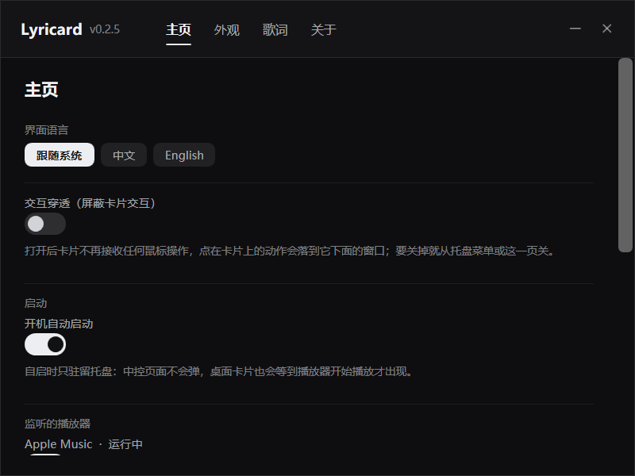
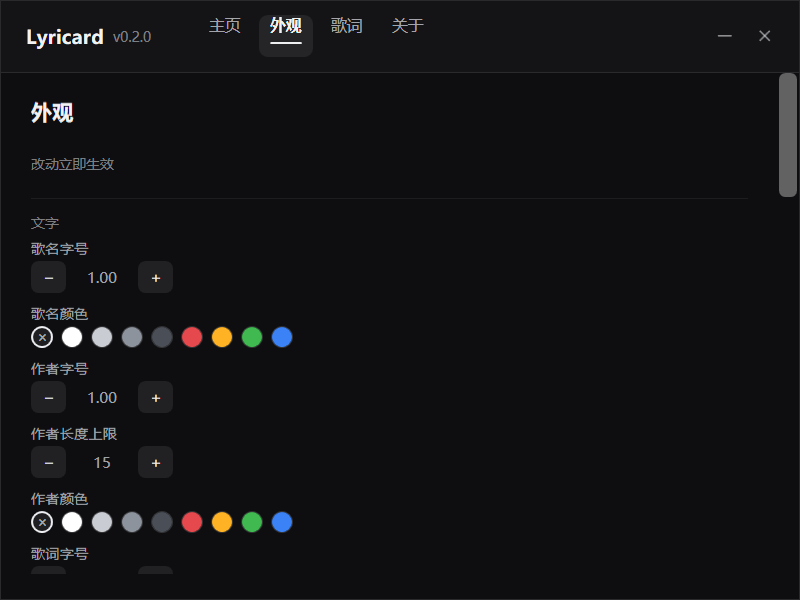
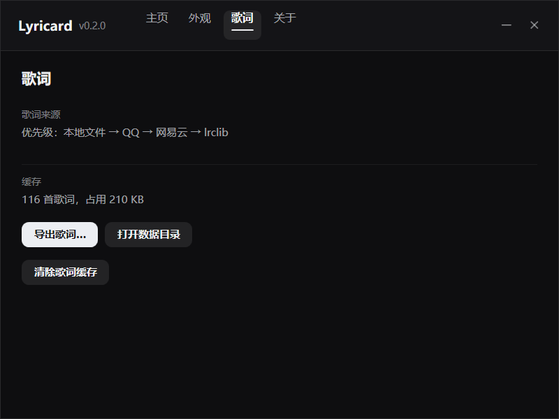
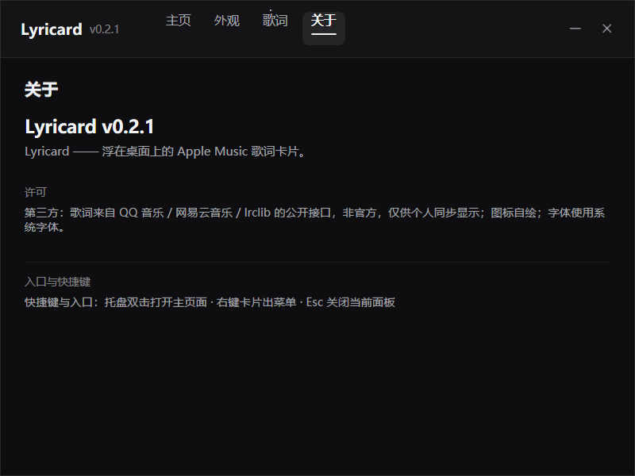

# Lyricard · 浮声

**一个浮在桌面上的歌词卡片** —— 默认只盯 Apple Music，也能跟网易云 / QQ 音乐 / Spotify 等 10 家播放器，谁在播就显示谁。

[](https://github.com/Liangpige/Lyricard/actions/workflows/build.yml)
[](LICENSE)
[](#快速使用)
[](https://github.com/Liangpige/Lyricard/releases)
[](#重新编译)


一个常驻 Windows 托盘的小工具：默认只盯 **Apple Music（Windows 版）**，也可以在主页里勾上**网易云 / QQ 音乐 / Spotify / 酷狗** 等 9 家播放器 —— 谁在播就显示谁。桌面角落显示：歌名 / 作者 / 单行同步歌词 / 进度条 / 上一曲·暂停·下一曲 / 圆形专辑封面。

版式：歌名与作者排在同一行（作者跟在曲名后面、字号更小、颜色更淡），歌名过长时会自己加省略号，并且**左边留两个字符的余量**、不会顶到最前面；**作者名默认最多 15 个字符**（设置里可改 4~40），超出截成「前 N-1 个字 + …」，不会把歌名挤没；文字、进度条、按钮**一律右对齐**到同一条右边缘，整块内容的高度不超过右侧封面，卡片整体 470×120。

**默认无背景**：只有文字和封面浮在桌面上，空白处的鼠标点击直接穿透到桌面。**整块界面只有封面带阴影**（文字、按钮、进度条都没有）；如果换成浅色壁纸觉得白字看不清，把「外观」页「卡片」组里的「文字阴影（浅色壁纸用）」打开，或者直接把文字颜色改成深色。想要带底的卡片，在「外观」页或托盘菜单里把「透明背景」关掉即可。

零安装、零管理员权限、无外部运行时依赖（只用系统自带的 .NET Framework 4.x + WPF）。

> **有的播放器要先在它自己的设置里打开 SMTC（系统媒体控制），Lyricard 才看得见它。**
> Apple Music、Spotify、Windows 媒体播放器默认就是开的；**网易云、QQ 音乐、酷狗**这类客户端要你自己去
> 「设置 → 系统/常规」里把「系统媒体控制」「SMTC」「任务栏歌词」一类的开关打开 —— 否则在 Lyricard
> 主页勾了它也不会有任何反应（不是它没播，是系统根本收不到它的会话）。酷我音乐根本没有这个开关，已经不在名单里。

## 快速使用

- 单文件程序，配置和歌词缓存在 exe 同目录的 `data\` 里；换机器时把这个目录整个拷走即可。
  - 请放在**普通用户目录**（例如 `%USERPROFILE%\Apps\Lyricard`），不要放 `C:\Program Files`：那里普通权限写不了 `data\`。
- 打开 Apple Music，卡片就会出现在屏幕右上角。苹果音乐在「还没开始播放」时不会对外发布媒体会话，所以卡片这段时间显示 `Apple Music / ♪ Waiting for music`（封面、进度条、播放按钮都收起来，只剩两行字）；一开始播放就切回正常歌词卡片，进度条和按钮用 200 毫秒淡回来。关闭 Apple Music 后卡片自动隐藏。
- 已经写入开机自启（`HKCU\Software\Microsoft\Windows\CurrentVersion\Run\Lyricard`），下次开机会自己在托盘里待命。不想要就在托盘菜单里关掉「开机自启」。
- 手动启动：双击 exe 即可。程序是单实例的，重复启动第二份会立刻自己退出（先启动的赢）。

## 卡片操作

| 操作 | 效果 |
| --- | --- |
| 左键拖拽 | 移动卡片（无背景时抓住文字 / 封面拖；位置会记住） |
| 滚轮 | 缩放卡片（0.55× ~ 2.2×） |
| 点击进度条 | 跳转播放位置（Apple Music 支持 seek 时） |
| 右键 | 打开卡片菜单 |
| 右键 → 打开主页面 | 打开主页面（外观页就是全部设置项，托盘图标双击同理） |

## 界面语言

面板最上面「界面语言」三选一：**跟随系统 / 中文 / English**（存 `data\config.ini` 的 `Lang=auto|zh|en`），切换当场生效，面板、卡片右键菜单、托盘菜单一起变。

- 「跟随系统」读的是 **Windows 显示语言**（`GetUserDefaultUILanguage`），不是 .NET 的 `CurrentUICulture` —— 这台机器上两者不一致（显示语言 `zh-CN`、`CurrentUICulture` 却是 `en-US`），只信后者会永远判成英文。
- 所有界面文案集中在 `src\Strings.cs`（`Zh` / `En` 两份字典，键名如 `menu.fetch_again`、`lbl.title_size`）。想加一门语言：复制一份字典、填好、在 `LangRow` 里加一格、`Config` 里放行新的 `Lang` 值即可。
- 取不到键时先回退中文、再回退键名本身，不会显示空白。
- 歌词栏那三句状态文案（`♪ Waiting for music` / `♪ Instrumental · no lyrics` / `♪ No lyrics available`）**不翻译**，各语言下都保持英文，保证不同歌词源、不同界面语言看到的文字完全一致。



## 交互细节

- 图标是手写的矢量图形（圆角矩形 + 圆角三角），不依赖任何图标字体，任何缩放下都清晰。
- 悬停按钮：淡白色圆底浮现 + 图标轻微放大 1.12×。
- 按下按钮：图标回弹（0.86× 压下、松开弹回）+ 一圈涟漪扩散；上一曲 / 下一曲还会朝各自方向轻推一下。
- 播放 / 暂停图标跟着实际播放状态切换（暂停时是 ▶，播放时是 ❚❚），切换瞬间带一个小弹跳。
- 换歌时标题淡入、封面淡入（0.3 秒），不是硬切。
- 鼠标进入卡片：三个按钮由 72% 淡到 100%，封面轻微放大 1.03×。
- 右键菜单是自绘的深色半透明面板（菜单项：个性化设置 / 重新获取歌词 / 导出歌词 / 换一个歌词源 / 提前·延后 / 放大·缩小 / 更透明·更不透明 / 锁定位置 / 监听所有播放器 / 界面语言（跟随系统·中文·English）/ 关闭卡片 / 取消）：圆角、白色文字、未勾选项颜色略淡、勾选标记在左侧、悬停时浮现一条淡白圆角高亮，分隔线是 1px 的细白线。**「透明背景」「封面旋转」只在设置面板和托盘里，右键菜单不再重复**。
- 封面缓慢自转：36 秒一圈（10°/秒），播放时转、暂停即停在当前角度、回到「Waiting for music」时归零；外圈描边和那层柔光阴影都挂在**不转的外层**上，所以只有封面图本身在转。「封面旋转」开关在设置面板和托盘菜单里。
- 右键菜单：打开期间**暂停**那条置顶巡检（否则 1.5 秒后卡片会盖住菜单）；点菜单外任意位置即关闭，这一下点击会被吞掉（不会顺带拖动卡片、也不会按到下面的按钮），和系统菜单的手感一致；菜单最下面有【取消】。
- 永远在最上层：窗口带 `WS_EX_TOPMOST`，并且每 1.5 秒重新把自己放回置顶层（不抢焦点、不闪烁）。别的「总是置顶」程序后来居上时，最多 1.5 秒会被卡片压回去；打开开始菜单/任务栏弹层的那一刻会让位，不会盖住系统 UI。
- 出现：260 毫秒，从自己的右上角微微放大（96.8% → 100%）+ 上移 6 像素 + 淡入，没有回弹、没有夸张位移。
- 消失：90 毫秒反向（缩小到 98.8% + 淡出，**不做位移**，原地淡掉）再隐藏；托盘「退出」也是先走这个淡出、100 毫秒后关进程，不会硬消失。
- 隐藏时如果又该显示（比如暂停后马上又播），动画不会打架：后一次会接管前一次，最后的隐藏动作只在自己仍是最新一次时才执行。
- 文字那一列不设显式宽度（交给 Grid 的星号列去撑），宽度只由卡片宽度反推 —— 否则内容比格子宽 1~2 像素时，WPF 会在右侧裁一刀，最右边的字就被切掉半截。
- 封面右边的光晕是偏移过的（往右下 4px、模糊 7），不往左漏，所以不会把歌词最后一个字压暗。
- 「透明背景」只换画法不改排版：边框厚度始终 1px（只把边框画笔置空）、字号也完全由设置面板决定，所以来回切换时文字和封面不会跳位（实测标题右缘 2395 / 封面右缘 2512 两种状态一致）。


## 主页面

**开机自启的行为**：自启时用 `--background` 启动 —— 中控页面不弹出，桌面卡片也不出现在桌面上，只有等到播放器开始上报播放（有播放会话）才跟着出现；想打开中控就在桌面双击 `Lyricard` 快捷方式（已在运行的实例会被叫醒，不会起第二份）。

双击快捷方式（或直接跑 exe）会打开一个 **4:3 的主页面**（640×480）。顶部是自绘导航条，四页都是实做的：

| 页面 | 内容 |
| --- | --- |
| **主页** | 界面语言（跟随系统 / 中文 / English，切换后整个界面与三处菜单立即生效）、开机自动启动开关、**监听哪些播放器**（内置 9 家 + 重新扫描 / 添加其它播放器） |
| 外观 | **全部外观项平铺**，分四组：文字（三处字号·颜色、作者长度上限、顶格余量、对齐）/ 进度条（长度·粗细·两种颜色）/ 封面（大小·饱和度·高光·阴影开关）/ 卡片（缩放·透明度·按钮位置·按钮颜色·背景·旋转·文字阴影），底部是**预设**（起名保存 / 点胶囊套用 / 点 × 删除）。没有「更多设置…」，也没有单独的设置面板了 |
| 歌词 | 来源优先级说明、缓存统计（首数与占用）、导出歌词 / 打开数据目录 / 清除歌词缓存（二次确认） |
| 关于 | 名称与版本、简介、第三方来源与许可说明、快捷入口说明 |

所有改动**即时生效并落盘**（改完不需要按保存）。导航条：品牌 `Lyricard` + 版本在左，右侧最小化 / 关闭（关闭 = 收起窗口，卡片和托盘继续跑）。

黑白灰三档：窗口底 `#0E0E10`、导航条 `#141417`、1px 描边 `#1EFFFFFF`；文字 96% / 55% / 30% 三档白，没有彩色。
窗口没有系统边框（自绘标题条），拖导航栏可以移动，Esc 收起。

**启动时的行为**：手动打开显示主页面；开机自启那条注册表值是 `"…\Lyricard.exe" --background`，登录时**只起托盘和卡片、不弹窗口**。
主页面随时可以从托盘双击、托盘菜单「打开主页面」或卡片右键菜单「打开主页面」再打开。

## 播放器绑定

主页面「监听的播放器」里可以勾选谁有权驱动卡片（`config.ini` 的 `BoundPlayers=apple-music,spotify`）：

- **内置名单 10 家**：Apple Music、Spotify、网易云、QQ 音乐、酷狗、MD3Music（酷狗第三方客户端，会话比官方版还规整）、foobar2000、MusicBee、AIMP、Windows 媒体播放器。（酷我音乐**不在名单里** —— 它从不注册媒体会话，列出来只会是个点不亮的开关。）新设备上会同时看两处 —— 正在跑的媒体会话（知道谁在运行）和开始菜单/App Paths（知道谁装了）。
- **只有勾上的播放器播放时卡片才出现**，没勾的一律忽略；浏览器永不自动入列（它们会把网页视频报成 Music）。
- **一个都不勾**＝谁都不监听，卡片不出现（`BoundPlayers=` 空值即此意）。想回到「Apple Music 优先」的旧行为就把 Apple Music 重新勾上。
- **名单外**：点「添加其它播放器…」，可从当前会话里直接勾，或输入程序名（如 `spotify.exe`），写成 `aumid:` / `exe:` 条目。
- 名单里的 AUMID 是按公开资料写的，没有在真机上逐家验证 —— 如果某家检测不到，用「添加其它播放器…」手动绑。

### 各家要不要手动开 SMTC

| 播放器 | 默认就能被看见？ | 要做什么 |
| --- | --- | --- |
| Apple Music | 是 | 什么都不用做（没开始播放时只有会话没内容，卡片显示 `♪ Waiting for music`） |
| Spotify | 是 | 什么都不用做 |
| Windows 媒体播放器 | 是 | 什么都不用做 |
| 网易云音乐 | **否** | 设置 → 系统 → 打开「开启 SMTC」（不同版本叫「系统媒体控制」/「任务栏歌词」） |
| QQ 音乐 | **否** | 设置 → 常规/系统 → 打开「系统媒体控制」一类的选项 |
| 酷狗音乐 | **否** | 设置 → 常规 → 打开「系统媒体控制」/「桌面歌词」一类的选项 |
| 酷我音乐 | **从不发** | 不支持，**已从名单移除**（装目录里连 SMTC 的字符串都没有，绑了也不会亮） |
| MD3Music | **是** | 实测 6.4.1：AUMID `com.md3music.md3music`，带 seek/rate 和总时长，兼容性最好的一家第三方客户端 |
| foobar2000 / AIMP / MusicBee | **看版本** | foobar2000 从 2.x 起自带（实测 2.26.3 直接就有会话），更老的版本或精简版可能没有；AIMP / MusicBee 一般要装插件。它们通常只报「在播」和位置、**不报总时长**，这时进度条没法算比例（已知问题，见下） |

> 表格里「默认就能被看见」只代表客户端会发会话；**能不能驱动卡片**还要在主页「监听的播放器」里把它勾上。

## 个性化设置

双击托盘图标（或双击快捷方式）打开主页面 → 「外观」页。所有选项直接铺在页面上，**改一项立刻在卡片上生效并写进 `data\config.ini`**，没有「完成 / 取消」要看。右侧是 10px 自绘细滚动条，和深色界面同一套灰阶。



| 歌词页 | 关于页 |
| --- | --- |
|  |  |

| 分组 | 能改什么 | 默认 |
| --- | --- | --- |
| 文字 | 歌名 / 作者 / 歌词的**字号倍率**（0.60× ~ 1.60×，步进 0.05）和**颜色**；**作者长度上限**（4 ~ 40 字）；**歌名顶格余量 / 歌词顶格余量**（0 ~ 200 px，留白，长文本不会顶到最前面）；**对齐方式**（左 / 中 / 右） | 1.00×、内置色、15 字、31 / 0 px、右对齐 |
| 进度条 | **长度**（50% ~ 160%，卡片宽度跟着变、右边缘钉住不动）、粗细（2 ~ 8 px）、轨道色、已播填充色 | 100%、3 px、透明背景时白 30% |
| 封面 | 大小（56 ~ 160 px）、饱和度、高光压制、**封面阴影**（开/关） | 96 px、0.10、0.06、开 |
| 文字（补充） | **文字阴影**（浅色壁纸用，默认关） | 关 |
| 卡片 | 整体缩放（0.55× ~ 2.2×）、整体透明度（0.30 ~ 1.00）、**下方按钮颜色**（留空 = 跟着歌词颜色走）、**下方按钮X轴位置**（0% ~ 100%，占「列宽 − 按钮组宽」的比例）、透明背景开关、封面旋转开关 | 1.00×、0.90、100%、开、开 |
| 行为 | 开机自启（主页）、监听所有播放器（卡片右键菜单） | 开、关 |
| 预设 | **自己做**（外观页最底部）：输入名字 → 点「保存当前」把现在这套外观存成胶囊；点胶囊名字立刻套用，点胶囊上的「×」删掉 | 空 |

- 颜色行：一排 9 个圆点 —— **第一个 `×` = 恢复内置色**（比如按钮色会退回「跟随歌词色」），其余 8 个是预设色。点哪个哪个外面立刻套白边，不用刷新页面。
- 字号倍率只影响文字大小，歌名可用宽度会跟着重算（`FitTitle` 用同一套倍率量宽），所以放大后不会顶出卡片。
- 调「长度」时卡片会跟着变宽变窄，但**右边缘钉在原处**（不会整块往左飘），歌名可用宽度也同步重算。
- 下方按钮 X 位置 0% 贴左、50% 居中、100% 贴右（默认）；列宽变化（进度条长度、封面大小）后会重算，不会漂。
- 对齐方式三选一（左/中/右）：**顶格余量跟着换边** —— 右对齐留在左边、左对齐留在右边、居中两边各一半。**进度条不受余量和 对齐影响，永远占满整列**（早先让它跟歌词余量走，结果调歌词留白时进度条跟着缩，已改掉）。默认右对齐 = 不加功能前的样子。
- 所有值都落在 `data\config.ini`：`TitleScale / ArtistScale / LyricScale`、`TitleColor / ArtistColor / LyricColor`（`#RRGGBB` 或 `#AARRGGBB`，留空 = 内置色）、`BarScale / BarThickness / BarColor / BarFillColor`、`ArtSize`、`ArtistMaxChars`（作者名最多几个字，4~40）、`TextAlign`（`right`/`center`/`left`）、`TitleIndent / LyricIndent`（歌名 / 歌词留白 px，0~200）、`ArtShadow`（封面阴影开关）、`TextShadow`（文字阴影开关，默认关）、`ControlsColor`（下方按钮颜色，留空 = 跟歌词颜色）、`ControlsX`（下方按钮 X 位置，0~100 的空余宽度百分比）。
- 预设存的是 26 个外观键（缩放/透明度/背景/封面调色与阴影/三处字号与颜色/作者长度上限/对齐方式/歌名与歌词顶格余量/按钮X位置/进度条粗细与长度与颜色/封面大小），**不含位置**；最多存 10 条，超了丢最早的；配置里写作 `Preset0=名字|k=v;k=v;…`。
- 「恢复默认」和「经典」预设是同一个东西：都调用 `Config.ResetLookDefaults()`，回到作者调好的出厂这套（缩放 0.85、整体透明度 0.94、歌词提前 1.6s、封面饱和 0.10 + 高光 0.06、进度条 3px/100%、封面 96、歌名左边留白 31px、歌词不留白、作者名 15 字）。卡片位置不参与重置。

## 封面调色

封面在解码后做一次逐像素处理（192px，每首歌只算一次，2~5ms），配置在 `data\config.ini`：

| 键 | 默认 | 作用 |
| --- | --- | --- |
| `ArtSat` | `0.1` | 饱和度保留比例；0 = 完全灰度，1 = 原样 |
| `ArtBlackAlpha` | `1` | 最暗处的不透明度下限；小于 1 时暗部会透出壁纸 |
| `ArtHiCut` | `0.06` | 最高亮度压低多少；只压 62% 灰以上的高光，纯白降 6%，暗部和中间调不动 |
| `ArtShadow` | `True` | 封面外圈那层柔光阴影，是整块界面**唯一**的阴影；关掉后封面是硬边贴在桌面上（阴影挂在不转的外层，不会跟着自转） |
| `TextShadow` | `False` | 文字/按钮的柔和阴影，默认关；浅色壁纸 + 白字看不清时才打开 |
| `ArtSpin` | `True` | 封面是否缓慢自转 |

三个值都改完要重启卡片生效。中间调（62% 灰以下）一律不动，所以压高光不会让整张封面变灰。

## 托盘菜单

- 显示 / 隐藏卡片（双击托盘图标同效）
- 重新获取歌词（当前歌曲换源重搜）
- 选择歌词…（列出所有候选与匹配度，自己挑一个）
- 歌词提前 / 延后 0.1s（对齐用，可叠加）
- 放大 / 缩小、更透明 / 更不透明
- 锁定位置（锁定后拖不动）
- 透明背景（默认开：无底、只有文字；关掉则恢复带底卡片 + 封面主色渐变）
- 监听所有播放器（默认只跟 Apple Music；打开后任何支持 SMTC 的播放器都会驱动卡片）
- 开机自启
- 退出（真正结束进程）

## 歌词从哪来

四个来源，按「歌名 + 艺人 + 时长」打分匹配：

1. **本地 `data\lrc\`**（最先看）——你自己丢进去的 `.lrc` 永远优先，离线、即时、完全信任（不做时长校验）。文件名写成 `歌名.lrc` 或 `歌名 - 艺人.lrc` 都行，按歌名相似度 ≥0.80 匹配。
2. **QQ 音乐 / 网易云音乐 / lrclib.net 三源并行**——谁先拿到 ≥3 行有效歌词就用谁，但会再等 **0.7 秒**让后到的更高分结果翻盘。
3. 标题含中日韩字符时优先 QQ/网易云，纯拉丁标题时优先 lrclib（谁先响应算谁的，只是排序与平票时的偏好）。
4. 网络超时 **4 秒**（以前 8 秒），三源并行后最坏情况从 ~38 秒降到 **~6 秒**。

菜单里的「**换一个歌词源**」会忽略当前这首歌正在用的那个源，重新取一次（比如 QQ 给的是翻唱版、想看网易云的）；点一次生效一次，且这次结果**不写缓存**，不会把你自己放的 `.lrc` 永久顶掉。

### 没有歌词内容时的三种状态（与来源无关）

不同来源对「这首歌没有词」的写法五花八门（`此歌曲为没有填词的纯音乐，请您欣赏` / `纯音乐，请欣赏` / `No lyrics yet` / `该歌曲暂无歌词` …）。卡片会把它们**全部归一化成同一个状态**，上屏只可能是这三句：

| 状态 | 上屏文案 | 判定方式 |
| --- | --- | --- |
| 还在取 / 前奏还没到第一句 | `♪ Waiting for music` | 本地或网络结果还没回来，或当前时间早于第一句歌词 |
| 这首歌没有人声 | `♪ Instrumental · no lyrics` | 任一来源给了占位文案、源标了 `pureMusic`、或歌名带「纯音乐 / Instrumental / 伴奏 / Karaoke」 |
| 四处都查不到 | `♪ No lyrics available` | 四个来源全部失败（连占位文案都没有） |

判定规则（`src\Lyrics.cs` 的 `Sanitize`）：

- 逐行过滤：命中 `纯音乐 / 纯音 / 没有填词 / 没有歌词 / 暂无歌词 / 无歌词 / 歌词未 / 敬请欣赏 / 请欣赏 / 此歌曲 / 该歌曲 / instrumental / no lyri… / lyrics … not / not available` 的行直接丢掉，并标记「这是纯音乐」。
- 整篇兜底：如果丢掉之后只剩 1~2 行、总长 ≤80 字、且命中更宽的 `NoticeRx`（额外含 `暂无 / 未有 / 未提供 / 还没有 / 暂时没有 / karaoke / off vocal`），整篇也判成纯音乐 —— 这样连没列举过的写法（例如「这首歌还没有歌词哦」）也能收进来。
- 本地 `.lrc` 里的占位写法同样走这套规则；一旦本地文件表明「没词」，就不再联网（你自己的文件说了算）。

三句文案收在 `CardWindow.TxtWait / TxtInstr / TxtNone` 三个常量里，改字只改一处。

### 没有装 Apple Music 的机器

桌面上**不会出现任何卡片**（不会再弹「找不到 Apple Music」那种提示）：程序只在托盘待命。要进界面就**双击托盘图标**，或者再双击一次快捷方式把主页面拉出来。

如果 Apple Music 装着、但当前没在播放，桌面卡片会正常出现并显示 `♪ Waiting for music`；一旦播放器开始播放，它就换成正在播放的歌。

「**导出歌词（分享用）**」（右键菜单和托盘都有）把缓存里的歌词批量写到 `data\lrc-export\`：文件名就是 `歌名 - 艺人.lrc`，内容是干净的 LRC，没有内部头信息，可以直接打包发给别人。这是**另外的文件夹**，不会影响卡片自己读 `data\lrc\`；想拿来自己用，把文件挪进 `data\lrc\` 就行。已有同名文件不会覆盖。

- 播放器给的 Artist 字段实际是「艺人 — 专辑」，会先拆开。
- 歌名里的 `(From "…")` 这类括号后缀会先清洗再搜。
- **接受门槛**：歌名相似度 ≥0.80，且（艺人相似度 ≥0.45，或艺人 ≥0.30 同时时长差 ≤4s）。同名但换了艺人的翻唱、混音版会被跳过——之前「纯音乐配上了别人歌词」就是这条没卡住。
- 源里标题带「纯音乐 / 伴奏 / instrumental」的候选，抓到空歌词会直接标记为纯音乐。
- 歌词文件里的作词/作曲/制作人/录音/`Operatic Vocals : ...` 这类署名行、平台广告行、重复时间戳会被过滤。
- 纯音乐（无歌词）会显示「♪ Instrumental · no lyrics」，不会把占位文案当歌词。
- 歌词在后台线程里取，切歌那一刻还没来得及回来，歌词栏先显示 `♪ Waiting for music`（不会空着）；歌曲开头前奏还没到第一句歌词时也是这句；手动「重新获取歌词」时显示 `♪ Searching lyrics…`。
- 结果缓存在 exe 同目录 `data\lyrics\`，同一首歌不再联网；本地 `data\lrc\` 的结果**不写缓存**，你改文件立刻生效。

## 同步精度

Windows 的 SMTC 报的进度**只精确到整秒**，而且 3~8 秒才刷新一批，直接拿过来用就会出现「有时快有时慢」。

程序的处理方式：

1. **只在时间轴真正跳变时重新锚定**（开关播放、拖动、换歌），其余时间保持「锚点 + 墙钟」的 1 倍速自走时钟——不会每次轮询都把时间戳刷新一遍。
2. 报上来的进度和自走时钟差 **≤2 秒**时当作「上游卡顿」，不纠正；2~4 秒之间只拉 40%（单步上限 1.5 秒）；超过 4 秒才认为是拖动/换歌，立刻对齐。
3. 界面每 33ms 刷新，歌词行切换带 0.35 秒迟滞，进度回退一点点不会把上一行翻回来，所以不会闪。

确实有整体偏差时，用托盘/右键菜单的「提前 / 延后 0.1s」微调，偏移量会存进配置。

## 文件

```
Lyricard\
  bin\Lyricard.exe     主程序
  data\config.ini        配置（位置、缩放、透明度、自启、歌词偏移）
  data\lyrics\           歌词缓存（100 条左右，删掉会重新联网取）
  data\lrc\              你自己放的 .lrc，优先级最高（离线可用）
  data\lrc-export\       「导出歌词（分享用）」的输出目录
  data\amc.log           运行日志（出问题时看这个）
  src\                       源码（C# 5，纯代码构建 WPF，不用 XAML）
  build.sh                   用系统自带 csc.exe 编译
  src\app.manifest           DPI 感知声明（PerMonitorV2），Windows 会按 125% 缩放正确渲染
```

## 重新编译

```bash
bash build.sh                 # 编译到 bin\，并（如果有安装目录）自动部署
```

注意：`csc.exe`（.NET Framework 4.0 自带的那个）按 ANSI 解析命令行参数，**带中文的绝对路径会被吞**，所以脚本先 `cd` 进 `src/` 只传裸文件名。C# 语言版本上限是 5（没有字符串插值、没有 `?.`）。

**先补 Windows SDK 的引用**（`libs/pkg/` 被 `.gitignore` 掉了，不含在仓库里）：项目只用到两枚 winmd —— `Windows.Foundation.UniversalApiContract` 与 `Windows.Foundation.FoundationContract`。它们来自 NuGet 包 `Microsoft.Windows.SDK.Contracts`（8.0.0 版即可），解出来放到 `libs/pkg/ref/netstandard2.0/` 下，文件名保持不变，`build.sh` 第 38–39 行就是按这个路径引用的。

其他要求：Windows 10 1809+ / 11，.NET Framework 4.6.2+（系统自带），不需要装 .NET SDK，也不需要 Visual Studio。

## 命令行开关

| 参数 | 作用 |
| --- | --- |
| （无） | 正常启动卡片 |
| `--ensure` | 兜底：如果 Apple Music 在跑、卡片没在跑，就把卡片拉起来；否则什么都不做 |
| `--smtcdump` | 把当前系统里所有媒体会话写进 `data\smtc.txt`，排查「卡片没出现」用 |
| `--lyrtest 歌名 艺人 [时长]` | 离线跑一遍歌词链路，结果写 `data\lyrtest.txt` |
| `--settings` | 启动时直接落到主页面「外观」页（截图/调试用；没有播放器也能用） |
| `--pick` | 启动后直接打开「选择歌词…」面板（没有播放器也能看） |
| `--uninstall [--silent]` | 卸载：退出程序、清开机自启、删 `data\`、删 exe（`--silent` 不弹确认框） |

## 卸载

托盘图标右键 →「卸载…」，或 `Lyricard.exe --uninstall`。会清掉开机自启、`data\` 目录和程序本身。细节与手删方式见 `INSTALL.md`。

## 已知限制

- **酷我音乐**：客户端根本不注册 SMTC（安装目录里连 `SystemMediaTransportControls` 这个字符串都没有），Windows 自己都不知道它在放歌。因此 v0.2.1 把它**从内置名单里删掉了** —— 留在列表里只会让人以为勾上就能用。
- **酷狗音乐**：有 SMTC，但位置数字常年不更新、暂停时还会跳回 0，和网易云同一类毛病。已用「自走秒表 + 只进不退 + 拖动时跟随」处理：进度条会跳、拖动只能近似对位。

这些是**实测撞过**的，写在这里免得以后当成 bug 重查一遍：

**关于播放器会话（SMTC）**

- **不报总时长的播放器（foobar2000 / VLC / 本地文件）不显示进度条**：它们只给位置不给总长，画不出比例，所以进度条整行收起来（在 foobar2000 里拖进度条也感知不到，只能等下一首）；歌词、标题、上下曲都正常，用歌词时间轴仍能跟上。
- **只认 Windows 的媒体会话（SMTC）**。不发会话的播放器（老版 foobar2000、千千静听等）根本看不见 —— 不是漏了哪个播放器，是它没上报。
- **默认开着的只有 Apple Music / Spotify / 系统播放器**。网易云、QQ 音乐、酷狗的 SMTC 开关默认是关的，得你自己进客户端设置打开（见上面那张表）；关着的时候 Lyricard 主页勾了它也不会亮，这是最常见的一句「怎么不动」。
- **浏览器永不自动入列**：Edge / Chrome 会把网页视频报成 Music、作者字段还经常是空的，所以内置名单里没有浏览器，只能手动 `aumid:` 绑定。
- **网易云像在"说谎"**：它常报 `Paused` 但其实在播，位置/时长常年是 `0`。现在的处理：①播放状态 = SMTC 报的状态 **或** 该播放器**自己那条音频会话**的真峰值（连续 5 拍 ≈1 秒 > 0.01 才判在播，暂停的淡出尾巴翻不动它），别的程序放声音不会再让它误判；②**只有它**的位置才算「可疑」：在播状态下位置冻住 3 秒、或明明在播却报 0 秒，才降级成「只进不退跟随」；Apple Music / Spotify 那种 3~8 秒才更新一次的粗粒度位置照常走精确对齐（±1.2 秒内缓动、超过就对齐）；③总时长优先用 SMTC，拿不到就读它自己的播放队列 `%LOCALAPPDATA%\NetEase\CloudMusic\webdata\file\playingList`（UTF-8 JSON，每条带毫秒时长），按歌名 + 艺人匹配，文件变了才重读；再不行才用「歌词末句 + 5 秒」估。副作用：**它的位置精度仍不如 Apple Music**（队列文件里没有播放位置）。
- **网易云关窗口 ≠ 退出**：它默认「关闭主面板时最小化到托盘」，进程还活着、会话还挂着（暂停在最后一首）。这时候卡片留着是对的 —— 托盘右键「退出」才会真的收起来。
- **幽灵会话**：有些客户端退出后 SMTC 条目还在系统里挂一会儿，卡片会捧着"上一首"不放。现在有一道 `IsGhost()` 检查：**该播放器自己的进程没了**（约 1 秒、连续 5 拍）就判定为幽灵并收卡。注意这里只看它自己的进程 —— v0.2.1 早期版本用的是"整机有没有声音"，结果你在刷视频/放游戏音效时，一个早就退出干净的播放器会被那张"还有声音"的判定保住在卡片上，看起来就像卡片自己弹了出来。未知播放器（推不出 exe）一律不判。命中时日志里会有 `smtc ghost dropped aumid=…`，选中会话变化时还会有 `smtc pick aumid=… status=… audible=…`。
- **QQ 音乐个别曲目时长报错**（实测有一首 7:31 的歌报成 21.7 秒），会影响进度条和最后一行歌词的落点。
- **一个都不勾 = 谁都不监听**：`BoundPlayers=` 空值就是"谁都不许驱动卡片"，不是"回到默认"。

**关于歌词与界面**

- 只有**行级**歌词（LRC），没有苹果自家的逐字 TTML：Windows 端的 Apple Music 把 TTML 放在需登录的接口里，且不落盘缓存，取不到。
- 匹配靠搜索接口打分，冷门曲目 / 现场版仍可能落到同名不同曲；宁可显示「No lyrics available」也不会硬塞。用「重新获取歌词」或偏移微调兜底。
- 颜色只能从 9 个预设里挑，**没有任意取色**（旧设置面板里的系统取色对话框已经拿掉了；要新颜色目前只能手改 `config.ini` 里的 `#AARRGGBB`）。
- 系统托盘图标在溢出区里（Windows 11 默认折叠），需要的话自己拖到任务栏。

## 谁做的

这个项目是**一个人 + 一个 AI 编程智能体**合作出来的。分工写在这里，是因为「哪些判断是人做的、哪些代码是机器写的」对使用者与后续维护者都算重要信息。

### HYJLiang（项目作者）

- **定的方向**：做一个"浮在桌面上的 Apple Music 歌词卡片"而不是完整播放器；卡片要窄、要贴在角落、要能一眼看完。
- **定的审美**：版式怎么排、歌名与作者怎么分行、进度条粗细与长度、封面做成转动的圆盘、阴影只留封面那一圈柔光、按钮静止时半透明、纯黑底 + 两条白条 + 空心圆的图标样式。
- **定的边界**：不装 .NET SDK、不引第三方库、不用 XAML、单文件绿色版、包里不许出现本机路径与个人信息、许可证用 MIT、艺名用 HYJLiang。
- **验收与报障**：几乎每个版本的问题都是先被他用出来的 —— 卡片被别的窗口盖住、进度条卡在 0:00、暂停后进度往回跑、点了播放没反应、关掉播放器卡片不消失、找不到入口（托盘被折叠）。他把现象描述清楚，我才知道往哪查。
- **提供环境**：真机上的 Apple Music / 网易云 / QQ 音乐 / 媒体播放器、各种桌面壁纸（浅色、深色、彩色封面）、125% 缩放的 2560×1440 屏幕，这些是模拟环境替代不了的。
- **决定发不发**：版本节奏、要不要开源、要不要写更新记录，都是他拍板。

### AI 编程智能体（DeepSeek Harness）

- **全部源码**：约 6885 行 C#（含注释与空行 8165 行）（纯代码 WPF、C# 5），包括卡片渲染、窗口特效、右键菜单、托盘、主页面四个分页、外观页与预设、歌词取词与匹配、SMTC 会话读取、WASAPI 会话音量、配置读写。
- **技术方案与调试**：锚点 + 自走时钟的歌词同步；幽灵会话检测；位置信任降级（"只进不退跟随"）；播放/暂停指令锁；按进程的音频峰值判定；本地播放队列补时长。
- **踩坑与绕行**：WinRT 在 .NET Framework 下的互操作、`BitmapImage` 的缓存崩溃、低完整性令牌下看不到播放器进程、DPI 虚拟化导致的截图错位、`csc` 的 ANSI 参数吞中文路径、XAML 缺 `xmlns:x` 导致样式静默失效 …… 这些写进了代码注释与本文档。
- **周边工程**：`build.sh` 编译/部署/打包三档、图标生成器 `tools/icon.cs`、卸载器、`--ensure/--smtcdump/--lyrtest` 等调试开关、`docs/AUDIT.md` 两轮安全与相似度审计、README/INSTALL 全部文档。
- **它做不到的**：不能替你判断"好不好看"，也不能替你决定要不要发布；它给的是实现、证据与取舍说明，最后由人确认。

### 责任划分

代码由 AI 生成，**方向、验收与发布由作者负责**。使用前建议自己过一遍源码（总共不到 1 万行、无第三方依赖），尤其注意「已知限制」里列的那些行为；发现问题的 PR 与 issue 都欢迎。

## 许可证

本项目以 **MIT 许可证**发布，版权人为 **HYJLiang**，全文见仓库根目录的 [`LICENSE`](LICENSE)。

也就是说：你可以自由使用、修改、再分发（包括商业用途），条件是保留版权声明与许可证全文，并且作者不为你的使用后果负责。

几点边界，避免误会：

- 本项目**不是** Apple 的产品，与 Apple Inc.、腾讯、网易均无隶属关系；"Apple Music"、"QQ 音乐"、"网易云音乐" 等名称仅用于说明兼容的播放器。
- 歌词文本来自对应平台的公开接口或你自己放进去的 `.lrc`，**版权归各权利人**；本工具只在你自己的机器上显示，不存储、不再分发歌词内容（`data\lrc\` 与 `data\lrc-export\` 是你自己机器上的文件）。
- 图标与界面素材为本项目自绘，随本项目一并按 MIT 授权。
- 没有内置任何第三方库或二进制，发行包里只有 `Lyricard.exe` 和几份说明文件（不含任何 dll / winmd / 快捷方式）。

## 更新记录

### v0.2.2（2026-11-24）

- **修**：放着视频/游戏音效时，一个早就退出的播放器会被「整机有声音」这条判定保活在卡片上；现在幽灵会话只看它自己的进程。
- **修**：「有声音在播，但播放器没上报曲目」这张提示卡以前只要**整机有声音**就弹，于是你在浏览器里刷抖音它也会冒出来。现在只有在「**已知播放器**自己在发声、却没有任何会话」时（也就是它真的忘了开 SMTC）才提示，并写出是哪一家。

### v0.2.1（2026-11-24）

- **细节**：激活的页签不再随鼠标发亮（它已经有下划线）；下划线改成 140 ms 淡入淡出，切换页签时视线不会被"跳一下"打断；分段控件（界面语言）也补了同样的淡变与按压缩放。
- **修复**：`RebuildAll()` 每次重建都清空页签登记表，反复切换语言不再累积失效控件。
- **界面**：主页/外观/歌词/关于四页都加了大标题，分组之间用发丝线分隔（之前只有留白，层次糊在一起）。
- **动效**：页签、胶囊按钮、窗口小按钮改为颜色淡入淡出（120~170 ms）；按下有 97% 的缩放回弹；开关的滑块会滑动 160 ms 并交叉淡变而不是瞬移；切页时新内容淡入并上浮 6 px。
- **卡片**：出现 220 ms（0.965 → 1，上浮 8 px）；关闭从 140 ms 提速到 **47 ms**（上一版的 1/3，缩放幅度收到 0.990，太短再缩会像抖一下）。
- **播放器名单**：酷我音乐从内置名单移除（它从不发 SMTC 会话，勾了也不会亮）；名单从 10 家变 9 家。
- **导航栏**：页签文字改用 Grid 居中 + 1 DIP 光学微调，字面与左边 `Lyricard v0.2.2` 词标上下边界完全对齐（逐像素量过：29–44 / 29–44）。
- **设置入口合并**：卡片右键「打开主页面」直接落到「外观」页，旧设置面板退役（类保留，方便回退）；`--settings` 现在没有播放器也能用（之前它只置一个卡片启动标记，卡片不显示时参数被吞）。
- **修复**（代码审计发现）：配置文件不再写出空 `BoundPlayers=`（否则之后永远显示「未绑定」）；换歌不再沿用上一首封面；SMTC 偶发异常不再把卡片清空（连续 5 次才重置）；封面流会释放；播放/暂停/切歌命令串行执行；幽灵检测不再每 200 ms 泄漏进程句柄；总时长按 `End - Start` 计算；卸载会同时结束 `Lyricard.exe`；「打开数据目录」路径加了引号；重建设置界面时不再累积控件与拖拽命中表；托盘菜单与备用图标不再泄漏；音量计量加锁；`--ensure` 与单实例用同一个互斥量；预设的 × 不再顺带套用预设。

**v0.2.0（2026-11-23）**

- 版本号 0.1.1 → 0.2.0；许可证版权人写作 `HYJLiang`。
- 播放/暂停按钮：点击即刻换图标（1.5 秒指令锁，旧快照不会再把它翻回去），并且按 SMTC 原始播放状态决定发 Play 还是 Pause —— 之前用被音量纠正过的状态判断，会把"暂停"发成"暂停"，看起来像按了没反应。
- 网易云位置信任：只有它的位置才算可疑（冻结 3 秒 / 在播却报 0），降级成"只进不退跟随"（领先不超过 0.35 秒）；Apple Music、Spotify 那种粗粒度位置照常精确对齐。
- 新曲第一拍不再拿上一首的锚点预测（`newTrack` 重置），换歌时进度条立刻归零。
- 关掉播放器后卡片会自己消失（幽灵会话检测 `IsGhost()`）。
- 新增 `LICENSE`（MIT）与 README「许可证」小节，发行 zip 一并附带；`build.sh` 自动打包 LICENSE。
- README「已知限制」补上读网易云本地队列、日志含歌名、WASAPI 会话音量三处披露。

**v0.1.1（2026-11-23）**

- 外观页改成全量平铺（四组），删掉「更多选项…」和单独的设置面板；颜色换成 9 点色板（`×` = 内置色）；预设胶囊搬回外观页。
- 右侧滚动条换成 10px 自绘细条（原来那条自定义样式因为 XAML 缺 `xmlns:x` 一直没生效，界面上其实一直是系统滚动条）。
- 修：拖「饱和度 / 高光压制」封面不刷新（要走 `RefreshArt`，`ApplyLook` 不碰像素）。
- 修：颜色圆点点完不高亮；步进器区间与 `Config.Clamp` 不一致导致的"反向跳"（透明度 0.30→0.25、缩进 120→200）。
- 新增 `IsGhost()` 幽灵会话检测（见「已知限制」）。
- **网易云总时长**：SMTC 给 0 时读它本地播放队列 `playingList` 的毫秒时长（按歌名 + 艺人匹配），进度条与 `0:00 / 3:09` 恢复正常；位置越过时长 0.4 秒自动归零，循环不再走出歌词。
- **播放状态按进程判定**：WASAPI 从"整机峰值"升级成"该播放器自己的会话峰值"（`IAudioSessionManager2` → `GetProcessId` → 会话 `IAudioMeterInformation`），暂停的播放器不会因为你在看视频而被判在播。
- 图标改为纯黑底 + 两条白横线 + 白色空心圆。
- 新增 `LICENSE`（MIT）与 README「许可证」小节，发行 zip 里一并附带。
